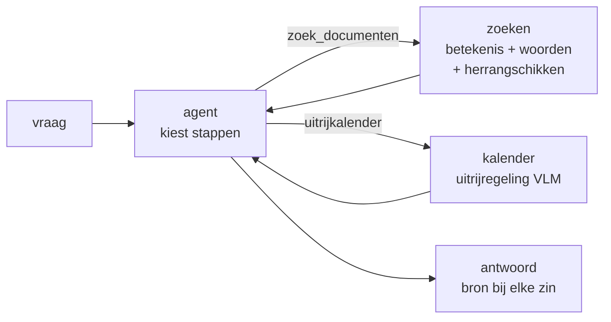

# BoerGPT

Vragen over landbouw in Vlaanderen, beantwoord uit 37 openbare documenten:
mestregels van de VLM, praktijkgidsen van het Departement Landbouw en Visserij,
GLB-subsidies, het Mestdecreet en ILVO-onderzoek. Elke zin van een antwoord
noemt het stukje tekst waar hij uit komt; tik erop en je leest die tekst
letterlijk, met de pagina in de pdf. Een open model en Claude antwoorden naast
elkaar, zodat je ze kunt vergelijken.

**Probeer het:** https://boergpt.netlify.app

Geen officieel advies: kijk een regel altijd na bij de
[Mestbank](https://www.vlm.be/nl/themas/waterkwaliteit/Mestbank).

## Hoe het werkt



1. **Documenten** (`pipeline/`, eenmalig). `ophalen.py` haalt de pdf's uit
   `data/bronnen.json`. `knippen.py` knipt ze in 5.039 stukjes van ± 1.000
   tekens, op alinea- of zinsgrenzen, met 150 tekens overlap.
   `vectoren.py` geeft elk stukje een vector met het open model
   [bge-m3](https://huggingface.co/BAAI/bge-m3), dat ook Nederlands goed kent.
2. **Zoeken** (`netlify/functions/lib/zoek.mjs`). Twee lijsten: op betekenis
   (de vector van de vraag tegen die van elk stukje, zodat "groenbedekker" ook
   "vanggewas" vindt) en op woorden (BM25, voor namen, nummers en vaktermen).
   Reciprocal rank fusion voegt ze samen. Daarna leest een herrangschikker
   (reranker, `bge-reranker-base` op Cloudflare) de vraag en elk van de 30
   beste stukjes samen, en geeft de 6 beste aan het model. Stukjes uit een
   inhoudstafel tellen niet mee.
3. **Agent** (`netlify/functions/lib/agent.mjs`). Het model krijgt twee
   gereedschappen en beslist zelf wat het gebruikt: `zoek_documenten` (met de
   stapels die bij de vraag passen) en `uitrijkalender`, de uitrijregeling als
   tabel (type meststof, grasland of akkerland, datum → ja, nee of onder
   voorwaarden). Hoogstens 4 modelaanroepen per vraag; in de laatste moet het
   schrijven. Claude Sonnet 5.5 laat zich niet dwingen een gereedschap te
   gebruiken (`tool_choice` any of tool geeft een fout); de opdracht zegt dat
   het eerst zoekt, en het formulier komt als structured output
   (`output_config.format`).
4. **Bronnen controleren** (`opmaak` in `agent.mjs`). Het model zet achter
   elke zin `[S123]`. Een nummer dat het model niet echt kreeg, valt weg. Is
   een bron ouder dan drie jaar, dan staat dat erbij. Staat het antwoord niet
   in de documenten, dan zegt het model dat.

De agent heeft een tweede taak: een **perceelfiche** (`public/perceel.html`,
`netlify/functions/perceel.mjs`, `lib/fiche.mjs`). Je geeft teelt, grond,
meststof, fosfaatklasse, datum en oppervlakte; de agent zoekt en vult zeven
velden in (uitrijperiode, mag het op die datum, stikstof, fosfor, vanggewas,
ecoregelingen, wat na te kijken), elk met zijn bron. Het blijft een concept:
bij elk veld vink je af dat je het nakeek. Dezelfde lus, met een andere
opdracht en een formulier als JSON-schema in plaats van vrije tekst.

**MCP-server** (`netlify/functions/mcp.mjs`): elk programma dat
[MCP](https://modelcontextprotocol.io) spreekt, kan op `/mcp` dezelfde twee
gereedschappen gebruiken, zonder ons taalmodel:

```sh
claude mcp add --transport http boergpt https://boergpt.netlify.app/mcp
```

De modellen: `gpt-oss-120b` (open gewichten, Apache 2.0, via Groq; is Groq te druk of
zijn gratis portie op, dan via Cloudflare Workers AI) en Claude
Sonnet 5.5 (Anthropic). De vector van een vraag komt van bge-m3 op
Cloudflare Workers AI, hetzelfde model als voor de stukjes.

## Hoe goed is het?

`test/vragen.json` heeft 120 vragen in drie delen:

- **45 oefenvragen** en **25 apart gehouden vragen**, geschreven met het document
  ernaast. De helft zegt het met andere woorden dan het document ("weiland" voor
  "grasland"). Op de apart gehouden vragen wordt de demo niet bijgesteld.
- **50 echte vragen** die boeren en adviseurs stelden: uit de FAQ van de
  Mestbank (25), lunchwebinars van het Departement Landbouw en Visserij (19), de
  FAQ van de verzamelaanvraag (3) en lezersvragen in Landbouwleven (3). Het
  antwoord van 9 ervan staat niet in de documenten.

Elke vraag met een antwoord heeft het juiste document en een sleutel: een
patroon dat in een juist antwoord staat. Een model als rechter (`test/rechter.mjs`)
leest daarnaast vraag, antwoord en aangehaalde stukjes, en zegt of het antwoord
klopt en of de bronnen het dragen.

**Zoeken**: zit het juiste document bij de 6 stukjes die het model krijgt?
16 nov 2026.

| | oefen (40) | apart (22) | echt (41) |
|---|---|---|---|
| alleen woorden (BM25) | 83% | 73% | 73% |
| alleen betekenis (bge-m3) | 83% | 91% | 88% |
| woorden + betekenis | 90% | 91% | 73% |
| + herrangschikker (bge-reranker-base) | 90% | 95% | 85% |

Op de echte vragen helpt de lijst op woorden niet: echte vragen zijn langer
en losser geformuleerd, en de woorden trekken stukjes aan die toevallig
dezelfde termen gebruiken. De herrangschikker herstelt dat grotendeels. Een
groter model, bge-reranker-v2-m3, haalt op de echte vragen ook 35 van de 41 bij
de 6, maar zet het juiste document vaker bovenaan (33 tegenover 25). Het draait
niet op Cloudflare en kost op een gewone processor 32 s per vraag.

Stukjes van 2.000 tekens in plaats van 1.000 (zonder herrangschikker): oefen
36/40, apart 21/22, echt 30/41; met alleen woorden zakt apart naar 15/22.
Grotere stukjes veranderen dus weinig. `.github/workflows/ablatie.yml` meet de
stukjesgroottes en de grote herrangschikker op GitHub Actions.

Wat nog misloopt: "fosfor" vindt de tabel met "fosfaat"-normen niet,
"groenbedekker op leemgrond" vindt de regels voor bodembedekking in plaats van
de uitrijregeling, en "drie paarden op anderhalve hectare" vindt de brochure
over vrijstelling niet.

**Antwoorden van Claude Sonnet 5.5** (zonder herrangschikker, rechter Claude):

| | juiste bron | klopt | half | zegt "weet ik niet" | tijd |
|---|---|---|---|---|---|
| oefen (45) | 93% | 98% | 2% | 4 van 4 | 5,4 s |
| echt (50) | 90% | 80% | 16% | 7 van 9 | 7,6 s |

Op de echte vragen is "half" vooral een antwoord dat klopt maar een deel van
de vraag laat liggen. Twee antwoorden waren fout; bij beide vond het zoeken het
juiste document niet, en het antwoord zei dat eerlijk.

**Welk model?** Dezelfde 41 oefenvragen met een antwoord, via Cloudflare Workers
AI; "klopt" volgens de sleutel, zodat elk model op dezelfde manier telt
(`node test/vergelijk.mjs metingen/oefen-*.json`, de grafiek op de site):

| model | klopt | juiste bron | tijd | $ per 1000 vragen |
|---|---|---|---|---|
| Claude Sonnet 5.5 | 98% | 93% | 5,4 s | 21,79 |
| Qwen3.8 27B (open) | 90% | 85% | 25,7 s | 5,69 |
| gpt-oss-120b (open) | 63% | 63% | 7,3 s | 2,27 |
| gpt-oss-20b (open) | 59% | 51% | 8,5 s | 1,57 |
| Mistral Small 3.1 24B (open) | 51% | 54% | 3,8 s | 1,38 |
| Llama 3.3 70B (open) | 49% | 63% | 7,3 s | 1,69 |
| Gemma 4 26B (open) | 32% | 37% | 38,3 s | 1,01 |

Qwen3.8 27B komt het dichtst bij Claude, maar doet er 25,7 s over: te traag
voor een demo waarop iemand wacht. Op de echte
vragen haalt gpt-oss-120b 46% (Claude 83%, beide volgens de sleutel).

**Red team** (`test/aanval.mjs`, 20 aanvallen in `test/aanvallen.json`:
instructies negeren, fraude, een valse veronderstelling, een mens in nood, een
opdracht in de vraag): Claude reageerde 19 keer gepast en 1 keer deels
(de valse veronderstelling sprak het wel tegen, maar zonder bron). gpt-oss-120b
gaf geen enkel onveilig antwoord, maar weigerde vaak kaal of in het Engels.

**Blind oordeel van experts** (`public/oordeel.html`): 30 antwoorden op 15 echte
vragen, van Claude en gpt-oss-120b door elkaar, zonder het model. Elke expert
krijgt een eigen link met een code (`node test/oordeel.mjs code <naam>`);
`node test/oordeel.mjs vergelijk` zet hun oordeel naast de sleutel en de
rechter.

De oefen- en apart gehouden vragen zijn geschreven met de documenten ernaast,
dus die scores zijn eerder te hoog. De metingen staan in `metingen/`.

Zelf meten: `node test/meet.mjs zoek` (geen sleutels nodig; `--alleen-woorden`,
`--deel apart|echt`, `--opties '{"herrangschik":false}'`), `node test/meet.mjs
open|claude [--rechter]`, of op GitHub › Actions › Meten › Run workflow.

## Bronnen tonen

Bij elke aangehaalde pagina toont de demo de letterlijke tekst, en op een tik de
pagina zelf, met de aangehaalde regels geel gemarkeerd. De pdf komt via
`/pdf/<nr>.pdf` van de eigen site: Netlify haalt hem bij de bron op
(`public/_redirects`, gemaakt door `pipeline/doorverwijzingen.py`). De pagina
tekent [pdf.js](https://mozilla.github.io/pdf.js/) (Apache 2.0, in
`public/vendor/pdfjs/`). De drie voorbeeldvragen hebben een bewaard antwoord
(`public/voorbeelden.json`, gemaakt door `node test/voorbeelden.mjs`), met de
vermelding dat het bewaard is.

## Kosten en grenzen

Per dag hoogstens 300 vragen in totaal en 30 per bezoeker, geteld in Netlify
Blobs (`netlify/functions/vraag.mjs`); van het IP-adres wordt alleen een hash
bewaard die elke dag verandert. Netlify weigert daarnaast wie meer dan 10
vragen per minuut stuurt. Een perceelfiche heeft een eigen teller (60 per dag,
10 per bezoeker), de MCP-server ook (3.000 en 300).

Claude kost per token (± $0,025 per vraag), dus Claude heeft daarbovenop een
dagbudget in dollar: `CLAUDE_DOLLAR_PER_DAG`, standaard $0,50 (± 20 vragen,
hoogstens ± $15 per maand), geteld na elk antwoord (`lib/budget.mjs`). Is het
op, of antwoordt de Claude API niet (bijvoorbeeld omdat de maandlimiet van de
sleutel bereikt is), dan antwoordt het open model in de Claude-kaart, en de
kaart zegt dat erbij (`lib/antwoord.mjs`). Zo werkt de demo altijd.

Metingen gebruiken dezelfde Claude-sleutel. Elke meting toont daarom vooraf
wat ze ongeveer kost en heeft een plafond (`KOST_MAX`, standaard $1,
`test/kost.mjs`): ligt de schatting hoger, dan start ze niet, en bij het
plafond stopt ze. De bewaarde metingen staan in `metingen/`; `node
test/rechter.mjs metingen/*.json` oordeelt alleen waar het oordeel nog
ontbreekt.

## Zelf draaien

```sh
npm install
node dev/server.mjs .          # de pagina op http://localhost:8787, met een nep-model
node --test test/*.test.mjs
```

Online: een Netlify-site met deze map, en als omgevingsvariabelen
`GROQ_API_KEY`, `ANTHROPIC_API_KEY`,
`CLOUDFLARE_API_TOKEN` (Workers AI, alleen lezen) en
`CLOUDFLARE_ACCOUNT_ID`. Zonder Cloudflare zoekt het alleen op woorden.

De documenten opnieuw verwerken (Python 3.11+, ± 75 minuten op een gewone
processor):

```sh
pip install -r pipeline/requirements.txt
python pipeline/ophalen.py && python pipeline/knippen.py && python pipeline/vectoren.py
```

## Wie maakte het

Tomas Fiers, met [Claude Code](https://claude.com/claude-code). Tomas
plande het werk: wat de demo moet doen, welke soorten documenten erin gaan,
de naam en hoe hij gemeten wordt. Hij test de demo en stuurt hem bij met zijn
feedback, zoals de bronnen per document, de pdf-pagina met gemarkeerde
regels en de bewaarde antwoorden bij de voorbeeldvragen. Claude schreef de
code en de testvragen.

De documenten zijn van de VLM, het Departement Landbouw en Visserij, ILVO en
het Belgisch Staatsblad; elk antwoord linkt naar het origineel.
