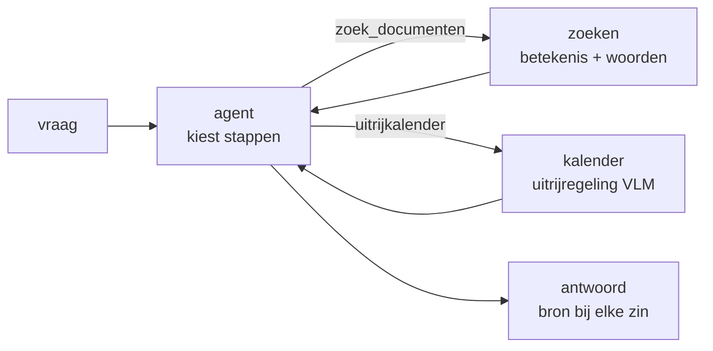

# BoerGPT

Vragen over landbouw in Vlaanderen, beantwoord uit 37 openbare documenten:
mestregels van de VLM, praktijkgidsen van het Departement Landbouw en Visserij,
GLB-subsidies, het Mestdecreet en ILVO-onderzoek. Elke zin van een antwoord
noemt het stukje tekst waar hij uit komt; tik erop en je leest die tekst
letterlijk, met de pagina in de pdf. Een open model en Claude antwoorden naast
elkaar, zodat je ze kunt vergelijken.

**Probeer het:** https://boergpt.netlify.app

Geen officieel advies: kijk een regel altijd na bij de
[Mestbank](https://www.vlm.be/nl/themas/waterkwaliteit/Mestbank).

## Hoe het werkt



1. **Documenten** (`pipeline/`, eenmalig). `ophalen.py` haalt de pdf's uit
   `data/bronnen.json`. `knippen.py` knipt ze in 5.039 stukjes van ± 1.000
   tekens, op alinea- of zinsgrenzen, met 150 tekens overlap.
   `vectoren.py` geeft elk stukje een vector met het open model
   [bge-m3](https://huggingface.co/BAAI/bge-m3), dat ook Nederlands goed kent.
2. **Zoeken** (`netlify/functions/lib/zoek.mjs`). Twee lijsten: op betekenis
   (de vector van de vraag tegen die van elk stukje, zodat "groenbedekker" ook
   "vanggewas" vindt) en op woorden (BM25, voor namen, nummers en vaktermen).
   Reciprocal rank fusion voegt ze samen. Stukjes uit een inhoudstafel tellen
   niet mee.
3. **Agent** (`netlify/functions/lib/agent.mjs`). Het model krijgt twee
   gereedschappen en beslist zelf wat het gebruikt: `zoek_documenten` (met de
   stapels die bij de vraag passen) en `uitrijkalender`, de uitrijregeling als
   tabel (type meststof, grasland of akkerland, datum → ja, nee of onder
   voorwaarden). Hoogstens 4 modelaanroepen per vraag.
4. **Bronnen controleren** (`opmaak` in `agent.mjs`). Het model zet achter
   elke zin `[S123]`. Een nummer dat het model niet echt kreeg, valt weg. Is
   een bron ouder dan drie jaar, dan staat dat erbij. Staat het antwoord niet
   in de documenten, dan zegt het model dat.

De modellen: `gpt-oss-120b` (open gewichten, Apache 2.0, via Groq) en Claude
Sonnet 5.5 (Anthropic). De vector van een vraag komt van bge-m3 op
Cloudflare Workers AI, hetzelfde model als voor de stukjes.

## Hoe goed is het?

`test/vragen.json` heeft 70 vragen: 62 met het juiste document en een woord
uit het juiste antwoord, 2 voor de uitrijkalender, 6 waarvan het antwoord niet
in de documenten staat. 36 vragen zeggen het met andere woorden dan het document
("weiland" voor "grasland"), één is in het Engels. 25 vragen zijn apart
gehouden: daarop wordt de demo niet bijgesteld.

**Zoeken** (zit het juiste document bij de 6 stukjes die het model krijgt?),
16 nov 2026:

| | oefenvragen (40) | apart gehouden (22) |
|---|---|---|
| alleen op woorden | 33 (83%) | 16 (73%) |
| woorden + betekenis | 36 (90%) | 20 (91%) |

Zoeken op betekenis helpt vooral als de vraag andere woorden gebruikt dan het
document. Wat nog misloopt: "fosfor" vindt de tabel met "fosfaat"-normen niet,
en "groenbedekker op leemgrond" vindt de regels voor bodembedekking in plaats
van de uitrijregeling.

**Antwoorden** (oefenvragen, 16 nov 2026), Claude Sonnet 5.5: de juiste bron
geciteerd bij 39 van 41 vragen (95%), het antwoord klopt bij 39 van 41 (95%),
en bij alle 4 vragen zonder antwoord in de documenten zegt het "Dat staat niet
in mijn documenten". Gemiddeld 5,4 s en ± 7.900 tokens in per vraag. Het open
model gpt-oss-120b haalt in de gratis laag van Groq hoogstens 200.000 tokens per
dag, minder dan één volledige meting.

De vragen zijn geschreven met de documenten ernaast, dus deze scores zijn
eerder te hoog dan te laag.

Zelf meten: `node test/meet.mjs zoek` (alleen het zoeken, geen sleutels nodig;
`--alleen-woorden` zonder vectoren, `--apart` op de apart gehouden vragen)
of `node test/meet.mjs open|claude`, of op GitHub › Actions › Meten › Run
workflow.

## Bronnen tonen

Bij elke aangehaalde pagina toont de demo de letterlijke tekst, en op een tik de
pagina zelf, met de aangehaalde regels geel gemarkeerd. De pdf komt via
`/pdf/<nr>.pdf` van de eigen site: Netlify haalt hem bij de bron op
(`public/_redirects`, gemaakt door `pipeline/doorverwijzingen.py`). De pagina
tekent [pdf.js](https://mozilla.github.io/pdf.js/) (Apache 2.0, in
`public/vendor/pdfjs/`). De drie voorbeeldvragen hebben een bewaard antwoord
(`public/voorbeelden.json`, gemaakt door `node test/voorbeelden.mjs`), met de
vermelding dat het bewaard is.

## Kosten en grenzen

Per dag hoogstens 300 vragen in totaal en 30 per bezoeker, geteld in Netlify
Blobs (`netlify/functions/vraag.mjs`); van het IP-adres wordt alleen een hash
bewaard die elke dag verandert. Netlify weigert daarnaast wie meer dan 10
vragen per minuut stuurt.

## Zelf draaien

```sh
npm install
node dev/server.mjs .          # de pagina op http://localhost:8787, met een nep-model
node --test test/teller.test.mjs
```

Online: een Netlify-site met deze map, en als omgevingsvariabelen
`GROQ_API_KEY`, `ANTHROPIC_API_KEY`,
`CLOUDFLARE_API_TOKEN` (Workers AI, alleen lezen) en
`CLOUDFLARE_ACCOUNT_ID`. Zonder Cloudflare zoekt het alleen op woorden.

De documenten opnieuw verwerken (Python 3.11+, ± 75 minuten op een gewone
processor):

```sh
pip install -r pipeline/requirements.txt
python pipeline/ophalen.py && python pipeline/knippen.py && python pipeline/vectoren.py
```

## Wie maakte het

Tomas Fiers, met [Claude Code](https://claude.com/claude-code). Claude
schreef de code; Tomas koos wat de demo moest doen, welke soorten
documenten erin gaan en hoe hij gemeten wordt.

De documenten zijn van de VLM, het Departement Landbouw en Visserij, ILVO en
het Belgisch Staatsblad; elk antwoord linkt naar het origineel.
